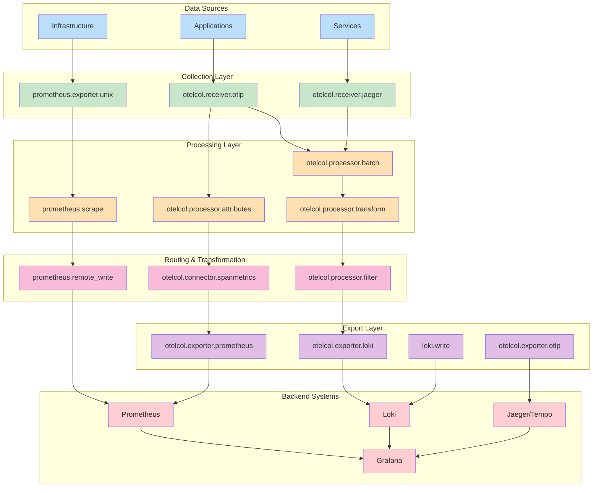

# Alloy Component Pipeline Diagrams

## OpenTelemetry Trace Processing Pipeline
*Based on `test_complex_references.alloy`*

```mermaid
graph TD
    A[otelcol.processor.attributes "default"] -->|traces| B[otelcol.processor.transform "default"]
    B -->|traces| C[otelcol.connector.spanmetrics "default"]
    C -->|metrics| D[otelcol.exporter.prometheus "default"]
    
    style A fill:#e1f5fe
    style B fill:#e8f5e8
    style C fill:#fff3e0
    style D fill:#fce4ec
```

**Flow Description:**
1. **Attributes Processor** → processes and modifies trace attributes
2. **Transform Processor** → applies transformations (keeps selected attributes)
3. **Span Metrics Connector** → converts traces to metrics
4. **Prometheus Exporter** → exports metrics to Prometheus

---

## OpenTelemetry Multi-Signal Receiver Pipeline
*Based on `demo.alloy`*

```mermaid
graph TD
    A[otelcol.receiver.otlp "default"] -->|metrics| B[otelcol.processor.batch "default"]
    A -->|logs| B
    A -->|traces| B
    
    B -->|metrics| C[Metrics Pipeline]
    B -->|logs| D[Logs Pipeline]
    B -->|traces| E[Traces Pipeline]
    
    style A fill:#e3f2fd
    style B fill:#f3e5f5
    style C fill:#e8f5e8
    style D fill:#fff3e0
    style E fill:#fce4ec
```

**Flow Description:**
1. **OTLP Receiver** → receives telemetry data via gRPC/HTTP
2. **Batch Processor** → batches data for efficient processing
3. **Signal Distribution** → routes to appropriate downstream processors

---

## Prometheus Scraping Pipeline
*Based on `test_single_file/main.alloy` and `components.alloy`*

```mermaid
graph TD
    A[prometheus.exporter.unix "database"] -->|targets| B[prometheus.scrape "database_scraper"]
    C[prometheus.exporter.unix "web"] -->|targets| D[prometheus.scrape "web_scraper"]
    
    B -->|forward_to| E[prometheus.remote_write "default"]
    D -->|forward_to| E
    
    E --> F[Remote Prometheus Server]
    
    style A fill:#e1f5fe
    style C fill:#e1f5fe
    style B fill:#e8f5e8
    style D fill:#e8f5e8
    style E fill:#fff3e0
    style F fill:#fce4ec
```

**Flow Description:**
1. **Unix Exporters** → expose system metrics (CPU, memory, filesystem)
2. **Scrape Jobs** → collect metrics from exporters
3. **Remote Write** → forwards metrics to external Prometheus server

---

## Complete Observability Stack Pipeline
*Combined pipeline showing typical full-stack setup*



---

## Component Types & Relationships

### 📥 **Receivers** (Entry Points)
- `otelcol.receiver.otlp` - Receives OTLP telemetry
- `otelcol.receiver.jaeger` - Receives Jaeger traces
- `prometheus.exporter.*` - Exposes metrics for scraping

### ⚙️ **Processors** (Transform Data)
- `otelcol.processor.batch` - Batches telemetry data
- `otelcol.processor.attributes` - Modifies attributes
- `otelcol.processor.transform` - Advanced transformations
- `otelcol.processor.filter` - Filters data

### 🔄 **Connectors** (Convert Signals)
- `otelcol.connector.spanmetrics` - Traces → Metrics
- `otelcol.connector.servicegraph` - Traces → Service topology

### 📤 **Exporters** (Send Data Out)
- `otelcol.exporter.prometheus` - Export to Prometheus
- `otelcol.exporter.loki` - Export to Loki
- `otelcol.exporter.otlp` - Export via OTLP
- `prometheus.remote_write` - Forward to Prometheus
- `loki.write` - Send logs to Loki

### 🏗️ **Pipeline Connection Types**
- **traces** = `[component.input]` - Trace data flow
- **metrics** = `[component.input]` - Metrics data flow  
- **logs** = `[component.input]` - Log data flow
- **forward_to** = `[component.receiver]` - Prometheus forwarding
- **targets** = `component.targets` - Scrape target configuration

---

## Call Hierarchy Patterns

The LSP call hierarchy provider tracks these relationship patterns:

1. **Array References**: `output { traces = [component.input] }`
2. **Direct References**: `targets = component.targets`
3. **Forward References**: `forward_to = [component.receiver]`

**Example Call Hierarchy Results:**
- **Incoming**: What components send data to this one
- **Outgoing**: What components this one sends data to

This enables navigation through the entire observability pipeline in your IDE.